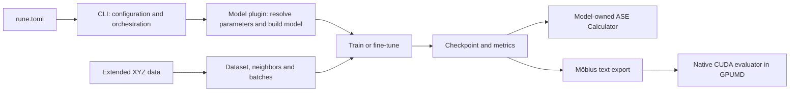
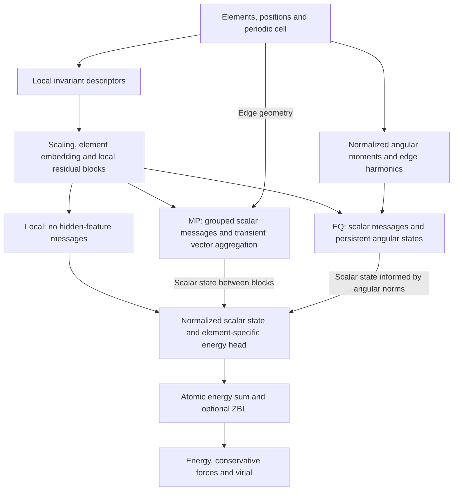

# RUNE and Möbius architecture

RUNE provides a common training and fine-tuning workflow for atomistic
potentials. Möbius is one model family implemented in that workflow; its Local,
MP and EQ variants differ in the information exchanged between atoms. The
[Möbius-OAM model cards](../models/README.md) describe specific trained weights,
their configurations and their evaluation results. An architecture selector
alone does not identify a trained model.

## RUNE workflow and ownership

A run directory contains `rune.toml` and the input data or paths to those data.
The [CLI](../rune/cli/run.py) reads the configuration, imports the selected model
plugin, resolves its parameters and constructs the model. The shared trainer
then handles energy, force and virial fitting, with single-process or
distributed execution. The current training path is specific to potential
fitting.

| Component | Responsibility |
|---|---|
| [`cli/run.py`](../rune/cli/run.py) | Validate common configuration and dispatch commands. |
| [`datasets/`](../rune/datasets/) | Read structures and labels, construct periodic neighbor geometry and form batches. |
| [`training/`](../rune/training/) | Training, fine-tuning, losses, optimization and epoch execution. |
| [`runtime/`](../rune/runtime/) | Distributed execution, checkpoint state, logging and random state. |
| [`nep/`](../rune/nep/) and [`mobius/`](../rune/mobius/) | Model parameters, descriptors, network, derivatives and external interfaces. |

Each model plugin exposes `resolve_params()`, `build_model()` and
`get_ddp_options()`. Loading, export and Calculator construction are optional
model capabilities. The shared CLI and trainer do not select a model through
model-name branches, and the two built-in model packages do not import one
another. This keeps model changes local while retaining common training
behavior.

Checkpoints record the plugin identity, resolved model parameters, run
configuration, model weights, optimizer and scheduler states, epoch, metrics
and random state. Full-state continuation checks the plugin and parameters;
weights-only fine-tuning starts a new optimization history. See
[`runtime/checkpoint.py`](../rune/runtime/checkpoint.py) and
[`training/finetune.py`](../rune/training/finetune.py).

## Common Möbius energy model

All three variants use an atomic energy sum, with an optional ZBL short-range
repulsion term:

$$
E_\theta(\mathcal X)
=\sum_i\left[\varepsilon_{i,\theta}^{\mathrm{learned}}(\mathcal X)
+\varepsilon_i^{\mathrm{ZBL}}(\mathcal X)\right],
\qquad
\mathbf F_i=-\frac{\partial E_\theta}{\partial\mathbf R_i}.
$$

The inputs are element identities, positions and the periodic cell. Radial and
angular neighbor lists retain periodic image displacements. The
[Möbius descriptor](../rune/mobius/descriptor.py) uses element-pair-dependent
radial functions and angular moment contractions to obtain local rotational
invariants. Its Chebyshev basis and NEP-style descriptor mathematics follow
the GPUMD conventions; the model owns its implementation independently of
RUNE's NEP package. The upstream mathematical implementation is available in
[GPUMD's NEP utilities](https://github.com/brucefan1983/GPUMD/blob/a8416f3466bc35741a33669a948cc3569d2c6be7/src/utilities/nep_utilities.cuh).

The descriptor is scaled by the stored `q_scaler`, projected to a shared hidden
space, combined with an element embedding and processed by local residual
blocks. An element-specific linear head reads the final normalized hidden
state into an atomic energy. The expensive hidden representation is shared
across elements; this does not mean that separate network blocks share their
weights.

Forces and virials are derived from this same energy. The PyTorch path uses
automatic differentiation for network partial derivatives and analytical
contraction for descriptor geometry. MP and EQ also contribute explicit edge
derivatives; EQ includes the angular-moment derivative carried by its
directional branch. These paths are combined in
[`model.py`](../rune/mobius/model.py), rather than fitting a separate force
output. RUNE returns a nine-component virial per structure; its ASE interface
converts the total virial to stress using $\boldsymbol\sigma=-\mathbf W/V$.

## Local, MP and EQ

The branches are alternative models, not consecutive stages of a single
network. Their names specify representation choices, not a guaranteed accuracy
ranking.

| Variant | Configuration selector | State retained between message blocks |
|---|---|---|
| Local | `message_mode = "scalar"`, `message_layers = 0` | Local scalar features; no hidden-feature messages. |
| MP | `message_mode = "scalar"`, `message_layers > 0` | Updated scalar features. |
| EQ | `message_mode = "equivariant"`, `message_layers > 0` | Scalar features and angular states for each configured order. |

### Local

Local reads the atomic energy directly from the local residual representation.
It already includes neighboring distances and angles through the many-body
descriptor. Setting the number of message layers to zero removes exchange of
hidden atomic features, not the geometric neighbors used by the descriptor.
Local weights must be trained for this architecture; deleting message layers
from an MP checkpoint does not preserve its predictions.

### MP: scalar state with transient directional information

The [MP block](../rune/mobius/message.py) divides scalar channels into groups.
Edge gates computed from radial basis functions and ordered element-pair
embeddings weight the neighboring scalar features before accumulation at the
receiving atom.

A narrower vector branch accumulates neighbor-conditioned scalars along edge
unit vectors. A channel mixing operation acts identically on the three spatial
components. Squared vector norms then convert this branch to scalar invariants,
which join the grouped scalar message in a residual update. The vectors are
recreated in each block and do not persist across blocks. `vector_channels = 0`
disables this branch without removing scalar message passing.

### EQ: persistent angular state with invariant gates

The [EQ implementation](../rune/mobius/equivariant.py) initializes angular states
from the descriptor's normalized angular moments. For each angular order
$\ell$, a channel projection is shared across its $2\ell+1$ components. The
normalization is part of the representation: raw NEP-style polynomial
components do not have the Euclidean metric used by the directional norms.

Each message block retains a state $H_i^{\ell}$ and updates it schematically as

$$
H_i^{\ell\prime}=H_i^\ell+
\sum_j f_c(r_{ij})\left[
a_{ij}^\ell W_\ell H_j^\ell+
b_{ij}^\ell Y_\ell(\widehat{\mathbf r}_{ij})\right].
$$

The gates are scalar, channel-dependent quantities shared across the angular
components of a given order. Their inputs include radial and element-pair
features, scalar contexts at both ends of the edge, and invariant projections
of each endpoint's angular state onto the edge harmonics. $W_\ell$ mixes
channels within the same angular order. Squared norms of the updated angular
states feed back into the scalar residual update.

Thus EQ transports directional information between blocks, whereas MP
contracts its directional branch immediately. The implementation uses scalar
gates, same-order projections and channel mixing. It does not implement a
general tensor-product algebra or arbitrary coupling between angular orders.
The [equivariance tests](../tests/test_mobius_equivariant.py) cover the specific
implemented transformations and derivative paths.

## ASE and native GPUMD deployment

The [ASE Calculator](../rune/mobius/interface/calculator.py) uses the PyTorch
model for energy, force and stress evaluation. The separate
[exporter](../rune/mobius/export.py) writes `mobius.txt`, including the branch,
element order, dimensions, descriptor definitions, scaler, ZBL settings and
parameters. Export does not refit or distill the model.

The optional [GPUMD adapter](../rune/mobius/install_gpumd.py) installs an explicit
CUDA evaluator that reads the model dimensions at runtime. It uses cuBLAS for
dense projections and does not require PyTorch or LibTorch during native
inference. The current native implementation uses double precision, reuses
scratch storage and caches candidate neighbors. Numerical comparisons must
use the same exported parameter values and account for arithmetic precision
and the transposed atomic-virial conventions between RUNE and GPUMD. See the
[deployment instructions](deployment.md) and
[integration tests](../tests/test_mobius_gpumd.py).

The native interface rejects neighbor overflow, unsupported partial-system
potential assignments and intermediate workloads outside its 32-bit indexing
range. For MP and EQ it also rejects heat-current observables:
`compute_hac`, `compute_hnemd`, `compute_hnemdec`, `compute_shc` and
`compute ... jp`. Correct forces and total virial do not establish a valid
atomic heat-current partition for a multi-hop model. The Local path is not
blocked by that check, but its heat-current partition and long-time transport
properties are not validated by interface parity alone.

## Architecture and model evidence

Implementation tests establish behavior for their tested inputs, configurations
and precisions. Prediction errors, material coverage and simulation stability
belong to a particular trained checkpoint and evaluation protocol. The
[model cards](../models/README.md) keep those identities separate from the generic
architectures described here. In particular, timings from small or randomly
initialized architecture configurations cannot be combined with a different
trained checkpoint's errors to form a speed–accuracy comparison.
